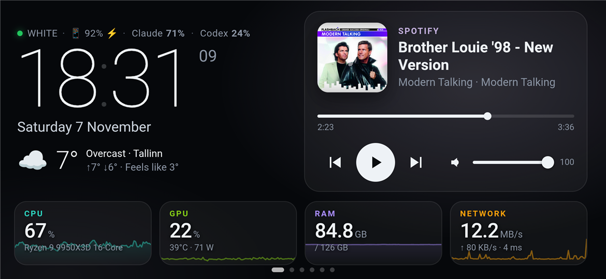
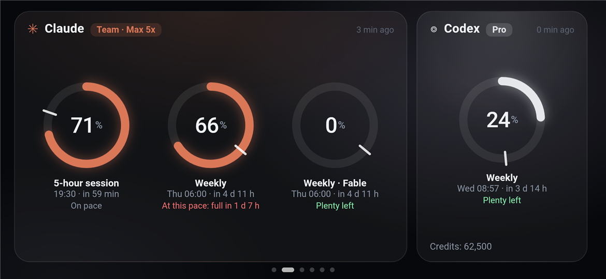
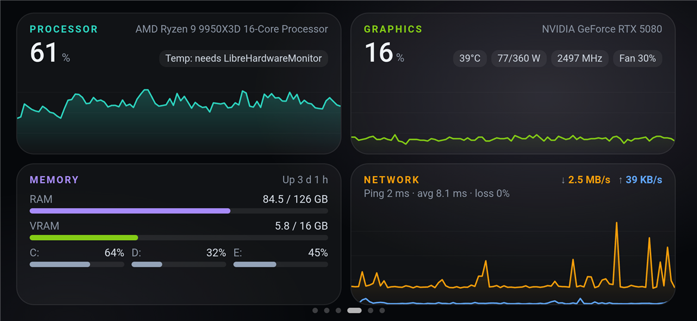
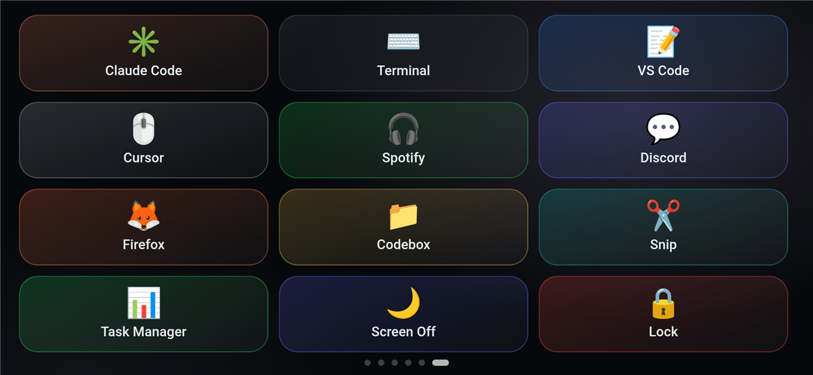

<p align="center"></p>

<h1 align="center">PhoneBox</h1>

<p align="center">Turn an old Android phone into a USB desk panel for your Windows PC.</p>

<p align="center"></p>

PhoneBox has two parts: a small **Android app** that runs full screen on the phone, and a **Windows agent** that
lives in the system tray and feeds it data over the USB cable (`adb reverse`), or optionally over Wi-Fi / Tailscale
after pairing once over USB. No cloud, no accounts.

## Pages

All pages, their order and their content are configurable from the settings page.

| | |
|---|---|
| **Home**: clock, date, weather (Open-Meteo), now playing with controls and volume, CPU / GPU / RAM / network tiles. | **AI quotas**: Claude and Codex usage limits with reset times and a burn-rate forecast ("at this pace: full in 1 d 5 h"). |
|  |  |
| **System**: live charts for CPU, GPU (NVIDIA), memory, disks, network and ping. | **Shortcuts**: a Stream Deck–style grid that launches apps, URLs or built-in actions on the PC. |
|  |  |

Two more pages:

- **Sessions & GitHub**: the live state of every Claude Code / Codex session (working, waiting for input, idle).
  The phone vibrates when a session finishes or needs you. Also shows review requests, your open pull requests with
  CI status, and unread notifications (via the GitHub CLI).
- **Processes**: the heaviest apps by CPU or RAM. Tap an app to see each instance (Claude Code instances show their
  session name) and end one instance with its child processes, or all of them. Windows-critical processes are locked.

The panel also dims itself at night (clock only), keeps the screen on, returns to the first page when idle and keeps
showing the clock and weather when the PC is off.

## Requirements

- Windows 10/11 with the [.NET 10 SDK](https://dotnet.microsoft.com/download) (the runtime is enough for the release zip)
- `adb` — `winget install Google.PlatformTools`
- An Android 9+ phone with USB debugging enabled
- Optional: an NVIDIA GPU (`nvidia-smi`), the GitHub CLI (`gh`), Claude Code, Codex,
  [LibreHardwareMonitor](https://github.com/LibreHardwareMonitor/LibreHardwareMonitor) with its web server on port 8085 for CPU temperature

## Install

```powershell
git clone https://github.com/ersinkoc/phonebox
cd phonebox
.\scripts\install.ps1 -Apk            # agent + phone app (add -Serial <id> if several devices are connected)
.\scripts\install.ps1 -Apk -Autostart # same, and start the agent with Windows
```

The agent installs to `%LOCALAPPDATA%\PhoneBox\app` and shows a tray icon. Plugging the phone in wakes it and opens
the panel. `.\scripts\uninstall.ps1 [-Purge] [-Apk]` removes it again.

## Settings

Double-click the tray icon (or open <http://127.0.0.1:8765>):

- **Pages**: show/hide and reorder pages; choose the home tiles, weather and media card, shortcut columns, whether
  processes may be ended from the phone.
- **Shortcuts**: add, edit, reorder and test keys (label, emoji, colour, command, arguments, working folder).
- **General**: weather location search, night mode, clock seconds, idle timeout, vibration, phone selection.
- **Advanced**: the raw JSON.

Settings live in `%APPDATA%\PhoneBox\config.json`; the phone picks up changes within a few seconds.

## Wi-Fi & Tailscale (optional)

Turn on **Settings › General › Wi-Fi & Tailscale**, restart the agent when asked, and plug the phone in once. Over
USB the phone receives the PC's addresses, a secret key and the fingerprint of the agent's self-signed TLS
certificate. When the cable is unplugged it switches to `https://<pc>:8766` automatically and back to USB when it is
plugged in again; the panel shows which one it uses.

- The phone and the PC need to be on the same network. If they are not (separate Wi-Fi networks, another
  building…), install [Tailscale](https://tailscale.com) on both: the agent offers its Tailscale address too.
- Windows Firewall asks once when Wi-Fi is turned on; allow it for the network types you use.
- The screen stays on, so the phone still needs a charger — just not necessarily the PC.
## How it works

```
 Android phone                                   Windows PC
┌───────────────────────────┐   USB / adb    ┌────────────────────────────────────┐
│ PhoneBox app (WebView)    │   reverse      │ PhoneBox agent (tray, .NET 10)     │
│  assets/www UI            │ ─────────────▶ │  127.0.0.1:8765 only               │
│  /agent/* → 127.0.0.1:8765│  tcp:8765      │  CPU/RAM/net, nvidia-smi, media,   │
│  (native proxy)           │                │  volume, processes, sessions, gh,  │
└───────────────────────────┘                │  quotas, shortcuts, settings UI    │
                                             └────────────────────────────────────┘
```

- The WebView never talks to the network for agent calls: requests to `/agent/*` are intercepted by the app and
  forwarded over the adb tunnel, so there are no CORS, mixed-content or local-network permission issues.
- Weather comes straight from [Open-Meteo](https://open-meteo.com/) on the phone.

## Security & privacy

- The agent listens on `127.0.0.1` only. Requests with a foreign `Host` header (DNS rebinding) or a cross-site
  `Origin` (CSRF) are rejected; only the settings page itself is accepted from browsers.
- The optional Wi-Fi port (8766) only serves the panel API, only over TLS pinned to the paired certificate, and only
  with the paired key. Settings, shortcut tests and pairing stay local. **New key** in the settings unpairs all phones.
- The phone only ever sends a shortcut **id**; the commands are defined on the PC.
- Ending processes is limited to your own session, never touches a list of Windows-critical processes, and can be
  switched off in the settings.
- **Claude quota:** read with the OAuth token Claude Code stores in `~/.claude/.credentials.json`, sent only to
  `api.anthropic.com/api/oauth/usage` (the endpoint behind Claude Code's `/usage`). The token is read-only: PhoneBox
  never refreshes it, so it can't interfere with Claude Code. This endpoint is undocumented and may change.
- **Codex quota and sessions** are read from local files in `~/.codex/sessions`; Claude Code sessions from
  `~/.claude/sessions`.

## Development

```powershell
.\scripts\build.ps1                          # dist\PhoneBox-<v>.apk + dist\PhoneBoxAgent-<v>-win-x64.zip
cd android; .\gradlew.bat assembleDebug      # APK only
dotnet run --project agent/PhoneBox.Agent    # agent from source
pwsh tools/make-icon.ps1                     # regenerate the .ico
```

Release APKs are signed with your own key when `PHONEBOX_STORE_FILE`, `PHONEBOX_STORE_PASSWORD`, `PHONEBOX_KEY_ALIAS`
and `PHONEBOX_KEY_PASSWORD` are set (in `~/.gradle/gradle.properties` or the environment); otherwise the debug key
is used. With the WebView debuggable in debug builds, `chrome://inspect` on the PC shows the panel's console.

## Extras

[`extras/umidigi-bison`](extras/umidigi-bison) has the reversible, no-root tune-up (debloat list, settings) used on
the phone PhoneBox was built for.

## License

[MIT](LICENSE)
